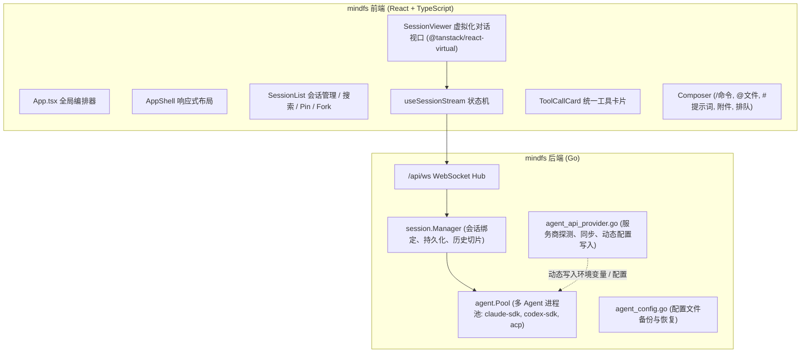
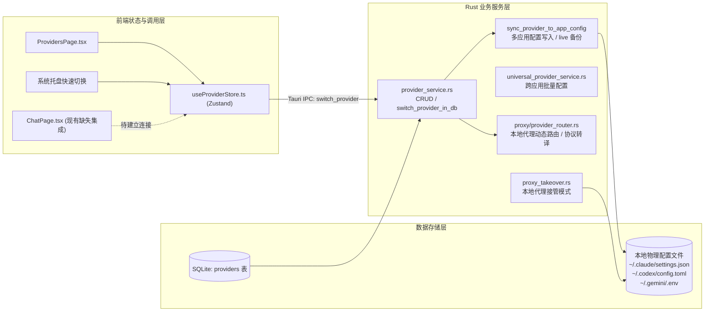
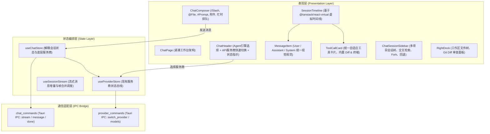
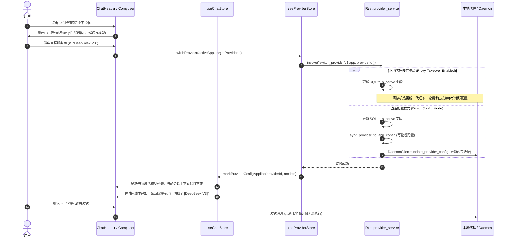

# Technical Design: 对话模块深度重构与服务商无缝切换对齐 mindfs

## 1. 系统架构与对齐现状分析

### 1.1 对标项目 mindfs 核心架构剖析
`C:\guodevelop\demo\mindfs` 是一个高度成熟的 AI Agent 远程访问网关与交互终端，其架构可提炼为以下核心支柱：



- **数据流特征**：
  1. 会话在建立后绑定到底层 Agent 进程，单条消息包含 `agent`、`model`、`effort`、`context`。
  2. 流式数据通过 WebSocket 双向传输，前端 `useSessionStream` 解析 `TimelineItem`，包括 `user_text`, `assistant_text`, `thought`, `tool`, `todo`, `plan`, `compact`。
  3. **服务商切换方式**：用户在服务商管理中增加 Provider 后，后台通过 `switchAgentAPIProvider` 直接覆写 Agent 的 CLI 配置或动态修改进程池环境变量（如 `ANTHROPIC_BASE_URL`, `ANTHROPIC_AUTH_TOKEN`），切换时不重置会话上下文。

### 1.2 本项目 ccg-switch 现有服务商配置机制剖析
`ccg-switch` 拥有非常完善的服务商底座，但该底座在对话层未充分释放：



**现有服务商机制组成部分**：
1. **模型与数据表**：`src-tauri/src/models/provider.rs` 中的 `Provider` 结构体，支持 `app_type`、`api_key`、`url`、默认模型集（Sonnet/Opus/Haiku/Reasoning）、`custom_params`、`settings_config` 以及 `proxy_config`。
2. **物理配置同步器 (`provider_service.rs:sync_provider_to_app_config`)**：
   - 自动在初次写入前将物理文件备份到 `~/.ccg-switch/backups/live/<app>/`。
   - 分别将环境变量与模型精确写入各个工具的配置文件。
3. **本地代理与接管引擎 (`src-tauri/src/proxy/`)**：
   - 本地代理服务器支持 Anthropic ↔ OpenAI / Gemini 双向协议转译。
   - **接管模式 (Takeover Mode)** 下，物理配置文件指向 `127.0.0.1:proxy_port`，请求到来时直接由代理实时读取 SQLite 中的 `is_active` 服务商。**这意味着更改数据库状态即可实现 0ms 零进程重启的热切换！**
4. **前端 Store (`useProviderStore.ts`)**：
   - 暴露 `providers`、`loadAllProviders`、`switchProvider(app, id)` 等，切换时会自动调用 `useChatStore.getState().markProviderConfigDirty()`。

---

## 2. 重构设计方案 (Refactoring Design)

### 2.1 整体分层架构



---

### 2.2 服务商在对话模块中的无缝切换流程设计

我们将“底层执行引擎”（Agent App: 如 Claude Code CLI、Codex CLI）与“API 服务商”（Provider Profile: 如 DeepSeek、Claude Official、OpenRouter）明确解耦。

#### 切换流程时序图



---

### 2.3 虚拟化时间线 (SessionTimeline) 设计

#### 核心数据结构
借鉴 `mindfs` 的 `useSessionStream` 与 `TimelineItem` 设计，消除原来逐字解析引发的重排：

```typescript
export type TimelineItem =
  | {
      id: string;
      type: "user_text";
      content: string;
      timestamp: number;
      agent: string;
      model?: string;
      attachments?: ChatAttachment[];
    }
  | {
      id: string;
      type: "assistant_text";
      content: string;
      timestamp: number;
      agent: string;
      providerId?: string;
      providerName?: string;
      model?: string;
      durationMs?: number;
      tokenUsage?: TokenUsage;
      isStreaming?: boolean;
    }
  | {
      id: string;
      type: "thought";
      content: string;
      isStreaming?: boolean;
    }
  | {
      id: string;
      type: "tool";
      toolCall: ToolCall;
    }
  | {
      id: string;
      type: "compact";
      info: CompactBoundaryInfo;
    };
```

#### 虚拟化滚动容器规范
- 使用 `@tanstack/react-virtual` 的 `useVirtualizer`：
  - `estimateSize`: 文本项预估 80px，工具块预估 120px。
  - `overscan`: 5，兼顾流畅度与内存开销。
  - `getItemKey`: `stableTimelineID(prefix, index, timestamp, id)`，保证增量渲染时节点稳定。
- **智能滚动锁定**：
  - 使用 `IntersectionObserver` 或滚动底差值判定用户视口是否紧贴底部（threshold ≤ 40px）。
  - 若在底部，流式帧由 `requestAnimationFrame` 驱动 `virtualizer.scrollToIndex(total - 1)`。
  - 若用户主动上滚，自动解除跟随，并在视口右下角弹出悬浮药丸按钮 `[↓ 有 3 条新内容]`，点击一键滚回到底部。

---

### 2.4 统一自适应工具调用卡片 (ToolCallCard)

将原有的 `GenericToolBlock`, `BashToolBlock`, `EditToolBlock`, `ReadToolBlock` 等归一化：

1. **头部 (Card Header)**：
   - 工具类型图标（Read 📖, Edit ✏️, Execute 💻, Search 🔍, AskUser ❓, Subagent 🤖）。
   - 工具名称及目标（如 `edit src/stores/useChatStore.ts`）。
   - 运行状态标签（`Running` 旋转圈, `Success` 绿色勾, `Failed` 红色叉）。
   - 耗时统计与展开/折叠箭头。
2. **主体 (Card Body)**：
   - **`edit` 类型**：内联轻量化 Unified Diff 视图，新增行浅绿、删除行浅红，文件名置顶，支持一键在右侧工作区 Dock 打开该文件。
   - **`execute` 类型**：终端黑色卡片，输出文本保持定宽字体，自适应当前卡片宽度，显示 Exit Code 与报错信息。
   - **`read` / `search` 类型**：代码折叠块，高亮关键搜索词。
3. **状态持久化**：
   - 建立单例 `ToolCallViewCache`（使用 `Map<string, boolean>` 记录展开/折叠状态），防止虚拟列表滚出屏幕再滚入时被强制重置为默认状态。

---

### 2.5 交互输入增强 (Composer)

- **Slash 命令补全 (`/`)**：
  - 触发条件：输入行首键入 `/`。
  - 候选列表：`/provider`（切换服务商）、`/model`（切换模型）、`/compact`（压缩上下文）、`/clear`（新建会话）、`/login`（登录 CLI）、`/help`（帮助）。
  - 支持键盘上下键选择，Enter 或 Tab 补全。
- **文件引用补全 (`@`)**：
  - 触发条件：键入 `@`。
  - 调用工作区文件检索，异步返回文件相对路径列表；选中后渲染为行内 Chip 标签，发送时自动转为系统附加上下文。
- **提示词预设补全 (`#`)**：
  - 触发条件：键入 `#`。
  - 联动 `usePromptStoreV2`，检索常用 Prompt 模板一键注入。
- **图片粘贴与附件管理**：
  - 监听 Composer 的 `paste` 事件与 `drop` 拖拽事件；提取图片 Blob，转为 Base64，生成缩略图条目，支持单项移除。
- **忙时消息队列 (Queued Messages)**：
  - 若当前有轮次正在生成或工具正在执行，用户点击发送不会阻断，而是推入 `useChatStore.queuedMessages`。
  - 在输入框上方显示 `[待发送: 1 条消息]` 胶囊标签。
  - 收到上一轮的 `chat://done` 事件后，自动按序消费队列，触发下一轮发送。

---

## 3. 兼容性与边界处理 (Compatibility & Edge Cases)

1. **对话进行中切换服务商的处理**：
   - **边界场景**：用户在 Agent 输出流式文字或执行长耗时工具命令时，点击切换服务商。
   - **防御策略**：
     - 若当前处于 `streaming: true` 或有工具正在执行，在 UI 下拉框给出微提示：“当前轮次正在执行中，切换将在本轮结束后生效”，或者允许用户一键终止当前轮次后再切换。
2. **不同服务商之间的模型兼容性映射**：
   - **边界场景**：用户原在 Claude 官方渠道使用 `claude-3-7-sonnet`，切换至某第三方中转提供商后，该提供商对应的模型可能命名为 `claude-3-7-sonnet-20250219` 或仅支持 `deepseek-chat`。
   - **防御策略**：
     - 切换服务商时，自动读取该 `Provider` 记录中的 `default_sonnet_model` / `default_opus_model` / `default_reasoning_model` 配置。
     - 若未配置，自动调用 `get_active_provider_models` 探查模型目录，并将选定模型重置为该服务商的推荐默认模型，避免因发送非法模型标识导致 400 报错。
3. **网络与鉴权异常降级**：
   - **边界场景**：新服务商的 API Key 失效或代理服务挂掉。
   - **防御策略**：
     - 捕获发送失败事件，通过 Toast 明确提示“服务商 [XXX] 连接失败: [错误详情]”。
     - 保留用户输入内容到 Draft 草稿中，绝不丢失用户刚打出的一大段文字。
     - 界面提供一键“切换回上一个服务商并重试”快捷按钮。
4. **历史会话兼容性**：
   - **边界场景**：加载历史会话（旧版本存储格式）时的兼容。
   - **防御策略**：
     - 时间线适配器对缺失 `providerId` 或 `model` 字段的历史消息做缺省兜底（默认标记为当时的全局默认服务商）。
