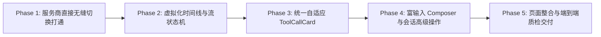

# Implementation Plan: 对话模块深度重构与服务商无缝切换对齐 mindfs

## 1. 实施路线图概览 (Phases Overview)

本项目重构采用**“底层打通 → 核心流水线重塑 → 组件收敛 → 高级交互 → 整体交付”**的渐进式实施策略，每一步均具备可验证的交付物与自动化测试防护网。

---

## 2. 分步骤实施规划 (Step-by-Step Implementation)

### Phase 1: 服务商无缝集成与热切换通道 (Provider Hot-Switching)
- **目标**：在对话界面直接连接 `useProviderStore`，实现用户随时在 Chat 内切换底层 API Provider，上下文完整保留。
- **任务分解**：
  1. **状态层联动**：
     - 在 `useChatStore` 中增加当前激活的 `activeProviderId`、`activeProviderName`、`activeProviderIcon` 属性。
     - 扩展 `useProviderStore` 的 `switchProvider` 回调，增加针对当前活跃会话的元数据标记通知，避免硬性重启 Daemon 造成会话清空。
  2. **Chat 顶栏/工具栏组件开发**：
     - 开发 `ChatProviderSelector.tsx`：展示当前应用（Claude / Codex / Gemini）及绑定的活跃 Provider，支持下拉快速切换。
     - 开发 `ChatModelSelector.tsx`：联动选中 Provider 的内置或探查模型列表。
  3. **后端热切换通道验证**：
     - 校验在本地代理接管模式（Proxy Takeover）下，切换 Provider 后下一轮对话立即生效。
     - 直连模式下，确保 `DaemonClient::update_provider_config` 及时热注入新的 BaseURL 与 API Key。
- **产出文件**：
  - `src/components/chat/ChatProviderSelector.tsx`
  - `src/components/chat/ChatProviderSelector.test.tsx`
  - `src/stores/useChatStore.ts` (Provider 联动扩展)

---

### Phase 2: 高性能虚拟化时间线与流状态机 (Virtual Timeline & Stream Engine)
- **目标**：引入虚拟列表，流式渲染性能从 O(N²) 降低到 O(1)，承载长达数百轮的重度对话。
- **任务分解**：
  1. **引入虚拟化依赖**：
     - 安装并验证 `@tanstack/react-virtual` 在 Tauri WebView 下的表现。
  2. **流式状态转换机**：
     - 参考 `mindfs/web/src/hooks/useSessionStream.ts`，实现 `src/hooks/useSessionStream.ts`。
     - 将原始的 text delta, tool use, thinking, compact boundary 解析归一化为标准的 `TimelineItem[]`。
  3. **虚拟化列表组件开发**：
     - 实现 `src/components/chat/SessionTimeline.tsx`，使用 `useVirtualizer` 动态测算高度。
     - 实现智能滚动锚定逻辑（`useChatScrollFollow`），上滚暂停跟随，底部浮标提示增量新消息。
  4. **MessageItem 统一视觉重塑**：
     - 重构 `src/components/chat/MessageItem.tsx`，对齐 mindfs 现代卡片视觉语言。
     - 增加 Hover 工具栏（一键复制、重新生成、分叉会话、元数据浮层）。
- **产出文件**：
  - `src/hooks/useSessionStream.ts` & `useSessionStream.test.ts`
  - `src/components/chat/SessionTimeline.tsx` & `SessionTimeline.test.tsx`
  - `src/components/chat/MessageItem.tsx`

---

### Phase 3: 统一自适应工具调用卡片 (Unified ToolCallCard)
- **目标**：彻底淘汰散落多处的单功能工具块，打造单一、高度自适应且带状态记忆的 `ToolCallCard`。
- **任务分解**：
  1. **卡片基础框架**：
     - 对标 `mindfs/web/src/components/stream/ToolCallCard.tsx`，创建 `src/components/chat/stream/ToolCallCard.tsx`。
     - 设计 Tool 图标渲染器与执行状态徽章（运行中、成功、异常中断）。
     - 实现 `ToolCallViewCache`，通过内存 Map 记录每个 `tool_use_id` 的展开/折叠状态。
  2. **内置 Diff 预览模块**：
     - 整合 `edit` 类工具的统一 Diff 视图，提供高对比度的增删行渲染、行号对齐与“在工作区打开”联动按钮。
  3. **内置命令终端模块**：
     - 整合 `execute` 类工具的黑底控制台展示，自适应宽度计算，显示完整命令、输出日志、Exit Code 与耗时。
  4. **交互类工具整合**：
     - 内置 `ask_user` 与权限请求确认，直接在卡片内完成单选、多选与自定义文本提交。
- **产出文件**：
  - `src/components/chat/stream/ToolCallCard.tsx`
  - `src/components/chat/stream/ToolCallCard.test.tsx`
  - `src/components/chat/stream/ThinkingBlock.tsx`

---

### Phase 4: 富输入 Composer 与会话高级操作 (Rich Composer, Fork, Rewind)
- **目标**：全面对齐 mindfs 的输入效率与会话分支管理。
- **任务分解**：
  1. **Composer 三重自动补全系统**：
     - `/` 唤起 SlashCommand 弹窗（`/model`, `/provider`, `/compact`, `/clear`, `/login`, `/help`）。
     - `@` 唤起工作区文件列表，支持键盘筛选，选中插入行内 Chip。
     - `#` 唤起 Prompt 预设库，选中后直接展开为完整提示词内容。
  2. **富附件处理**：
     - 增加剪贴板粘贴与拖拽图片支持，自动转为 Base64 并提供缩略图预览条。
  3. **忙时排队队列 (Queued Messages)**：
     - 支持在 Agent 执行时连续发送，自动推入队列，一轮完成后无缝触发下一轮。
  4. **会话 Fork 与历史编辑**：
     - 在历史消息卡片增加「从此处分叉 (Fork Session)」，调用后端生成衍生会话。
     - 增加「编辑并重发」，截断后续消息重新运行。
- **产出文件**：
  - `src/components/chat/composer/RichChatComposer.tsx`
  - `src/components/chat/composer/RichChatComposer.test.tsx`
  - `src/components/chat/composer/CommandPopover.tsx`

---

### Phase 5: 页面整合与全链路质检验收 (Integration & Quality Gate)
- **目标**：重构 `ChatPage.tsx`，串联各模块，执行完整的质量验证与回归测试。
- **任务分解**：
  1. **ChatPage 主视图组装**：
     - 移除旧的冗余布局与重复的状态栏，采用对齐 mindfs 的清爽布局：左侧会话侧栏 + 中央主对话区 + 右侧工作区 Dock。
  2. **双向联动贯通**：
     - 点击 ToolCallCard 中的文件直接在右侧 Dock 文件树与 Diff 审查器中定位打开。
     - 右侧文件树点击可直接在 Composer 中插入 `@` 引用。
  3. **全量自动化测试与类型检查**：
     - 运行 `npm run build` (`tsc && vite build`)。
     - 运行 `cargo check --manifest-path src-tauri/Cargo.toml`。
     - 运行前端单元测试套件 `npm run test`。
  4. **性能基准对比**：
     - 对比重构前后长对话首屏加载耗时、流式渲染帧率、内存占用。
- **产出文件**：
  - `src/pages/ChatPage.tsx` (重构版)
  - `src/pages/ChatPage.test.tsx`

---

## 3. 详细测试计划 (Detailed Test Plan)

为确保重构后的交付质量，制定涵盖单元测试、集成测试、边界异常与性能压测的完整测试矩阵：

### 3.1 单元测试清单 (Unit Tests)

| 模块 | 测试文件 | 核心用例覆盖 |
|-----|---------|-------------|
| **服务商切换联动** | `ChatProviderSelector.test.tsx` | 1. 正确过滤并展示当前应用可用的服务商列表 2. 点击服务商触发 `switchProvider` 3. 服务商切换后模型列表自动联动刷新 |
| **流式状态机** | `useSessionStream.test.ts` | 1. 流式文本分块累加，不丢字不乱序 2. 工具调用状态转换（running → complete/failed） 3. `thought` 块独立解析与闭合 4. Compact 压缩边界标记识别 |
| **虚拟时间线** | `SessionTimeline.test.tsx` | 1. 初始渲染只挂载可视区域 DOM 节点 2. 快速滚动时平滑加载视口节点 3. 保持底部锁定行为符合预期（上滚暂停、到底恢复） |
| **统一工具卡片** | `ToolCallCard.test.tsx` | 1. 正确识别 read、edit、execute、ask_user 种类 2. Edit 工具高亮展示 Unified Diff 增删行 3. Execute 工具展示控制台输出并适配宽度 4. 展开/折叠状态被 Cache 正确记忆 |
| **富输入输入框** | `RichChatComposer.test.tsx` | 1. 键入 `/` 唤起命令候选，Enter 键补全 2. 键入 `@` 唤起文件联想，选中生成 Chip 3. 粘贴图片自动解析为 Attachment 缩略图 4. 忙时发送消息正确进入 `queuedMessages` |

### 3.2 集成测试场景 (Integration Scenarios)

1. **场景 1：无缝热切换服务商测试 (Seamless Provider Hot-Switching)**
   - **步骤**：
     1. 进入 ChatPage，选择服务商 A（例如 Anthropic 官方）并发送一条消息，得到正常回复。
     2. 不离开页面，直接在顶栏下拉框切换为服务商 B（例如 DeepSeek V3）。
     3. 紧接着发送第二条消息：“请继续上一轮的话题”。
   - **预期**：
     - 对话历史完整保留，无需重连页面。
     - 第二条请求由服务商 B 成功响应，Assistant 消息下方标注 `DeepSeek V3` 标签。
2. **场景 2：长对话高频流式与滚动跟随测试 (Streaming & Scroll Follow)**
   - **步骤**：
     1. 加载包含 50+ 轮次、包含大段代码生成与终端执行的历史会话。
     2. 发送新消息要求输出一段上千行的长文本。
     3. 在输出过程中，测试鼠标主动向上滚动查看历史记录，然后再点击「回到底部」悬浮药丸。
   - **预期**：
     - 首屏及流式渲染丝滑无白屏，无卡顿掉帧。
     - 主动上滚时自动解除强制滚底，点击药丸后瞬间平滑回归最底部最新 token。
3. **场景 3：会话分叉 (Fork Session) 数据一致性测试**
   - **步骤**：
     1. 选择会话中第 5 轮 Assistant 回复，点击「从此处分叉」。
     2. 验证新建会话的内容是否为原会话前 5 轮的深拷贝。
     3. 在新会话中切换另一个服务商并继续对话。
   - **预期**：
     - 原会话与新分叉会话互不干扰，分叉会话成功延续上下文。

### 3.3 异常与边界防御测试 (Resilience & Edge Cases)

1. **服务商网络异常与鉴权失败**：
   - 切换到一个配置了无效 API Key 的服务商，发送消息。
   - 验证：系统通过浮动 Toast 明确提示错误原因，输入框文字不被清空（保留草稿），并提供“切换回原服务商”快捷操作。
2. **生成过程中强行切换服务商**：
   - 在流式生成中途切换服务商。
   - 验证：界面提示“当前生成结束后生效”或友好提示先终止再切换，避免底层流混乱。
3. **超长无空格代码与超宽终端输出**：
   - 工具执行返回大量单行超长字符（如 Minified JS、超长 Base64）。
   - 验证：ToolCallCard 内置 `break-all` 和横向滚动条，严禁破坏外层页面栅格布局。

---

## 4. 交付物清单 (Expected Deliverables)

1. **核心组件集**：
   - `src/components/chat/ChatProviderSelector.tsx` (服务商快速无缝切换器)
   - `src/components/chat/SessionTimeline.tsx` (虚拟化时间线视口)
   - `src/components/chat/stream/ToolCallCard.tsx` (统一工具调用卡片)
   - `src/components/chat/composer/RichChatComposer.tsx` (富交互输入框)
2. **状态与适配层**：
   - `src/hooks/useSessionStream.ts` (流式增量状态机)
   - `src/stores/useChatStore.ts` (解耦并支持运行时无缝热切换服务商)
3. **页面级整合**：
   - `src/pages/ChatPage.tsx` (完整重构交付版)
4. **测试与质量保证**：
   - 对应配套的 5 套前端核心自动化测试文件
   - `npm run build` 与 `cargo check` 零错误零警告
